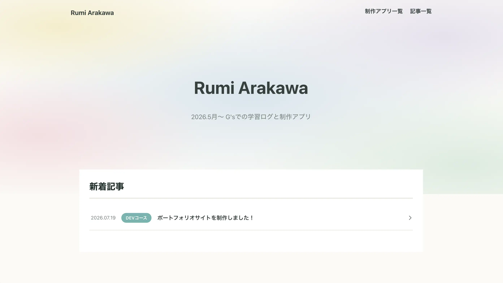
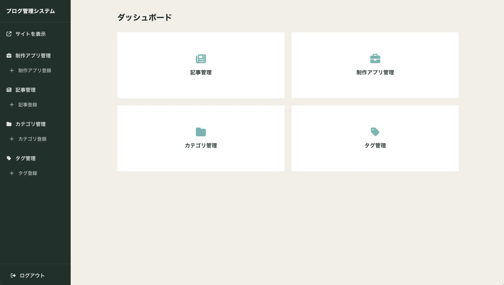
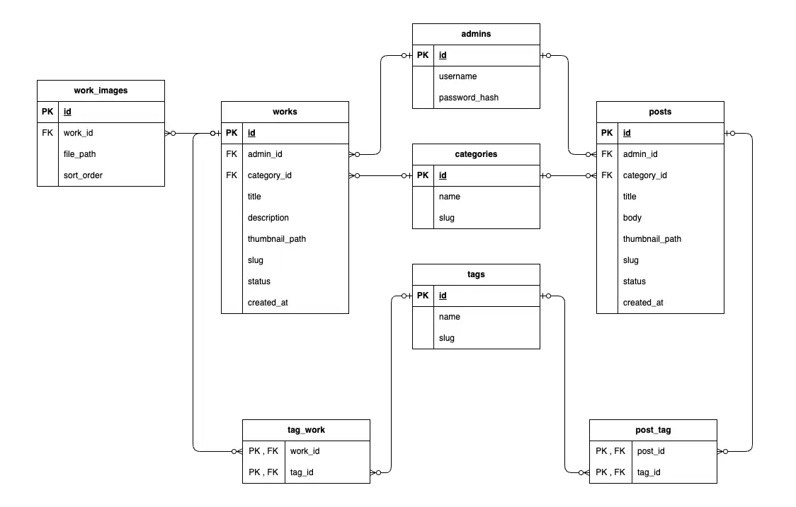

# ポートフォリオ・ブログ管理システム



ブログ記事（posts）と制作アプリ（works）を管理画面から投稿・編集し、公開ページに表示するポートフォリオサイトです。転職活動で使う自分のポートフォリオを、CMS を使わずに PHP × MySQL で自作しました。

- **デモ**：https://gs2026-arakawa.sakura.ne.jp/kadai09_auth/public/index.php
- **管理画面**：https://gs2026-arakawa.sakura.ne.jp/kadai09_auth/admin/login.php
- **テストアカウント**：ログイン情報は個別にお伝えします



---

## 主な機能

### 管理画面

- ログイン・ログアウト（セッション認証、30分操作がないと自動ログアウト）
- ブログ記事・制作アプリの登録・編集・削除
- カテゴリ・タグの登録・編集・削除と、記事・アプリへの付与（タグは複数選択可）
- サムネイル画像のアップロード・差し替え・削除
- 制作アプリへのギャラリー画像（複数枚）の登録
- 「下書き」と「公開」の切り替え

### 公開ページ

- ブログ記事・制作アプリの一覧と詳細（公開状態のものだけを表示）
- 制作アプリのギャラリー画像をクリックで拡大表示（ライトボックス）
- GitHub の自分のリポジトリ全体の使用言語比率をトップページに表示

---

## 使用技術

| 分類 | 技術 |
|---|---|
| フロントエンド | HTML / CSS / JavaScript（ライブラリなし） |
| バックエンド | PHP（フレームワークなし・PDO） |
| データベース | MySQL |
| 外部API | GitHub REST API |
| インフラ | さくらのレンタルサーバー（本番）／ MAMP（ローカル開発） |

### ディレクトリ構成

```
.
├── admin/             # 管理画面
│   ├── posts/          # ブログ記事のCRUD
│   ├── works/          # 制作アプリのCRUD
│   ├── categories/     # カテゴリのCRUD
│   ├── tags/           # タグのCRUD
│   └── _layout/        # 共通のhead・サイドバー
├── public/            # 公開ページ
│   ├── posts/          # ブログ記事の一覧・詳細
│   ├── works/          # 制作アプリの一覧・詳細
│   └── _layout/        # 共通のナビ・フッター
├── includes/          # 認証チェック・共通関数・画像アップロード・GitHub API連携
├── config/            # DB接続・セッション・.env読み込み
├── assets/            # CSS・JavaScript
├── uploads/           # アップロードされた画像
└── create.sql         # テーブル定義
```

---

## DB設計



| テーブル | 内容 |
|---|---|
| `admins` | 管理者 |
| `posts` | ブログ記事（カテゴリ・サムネイル・公開状態） |
| `works` | 制作アプリ（カテゴリ・サムネイル・公開状態） |
| `work_images` | 制作アプリのギャラリー画像（並び順） |
| `categories` / `tags` | カテゴリ、タグ（posts と works で共通） |
| `post_tag` / `tag_work` | 記事・アプリとタグの中間テーブル |
| `github_language_stats` | GitHub の言語別コード量のキャッシュ |

テーブル名は Laravel の命名規則（複数形のテーブル名、中間テーブルは単数形をアルファベット順に連結）に合わせています。

---

## 工夫した点

### 管理画面と公開ページの出し分け

- 同じテーブルを管理画面と公開ページの両方で使い、公開ページでは `status = 'published'` のものだけを取得するようにしました。下書きの記事は URL を直接指定しても表示されません。

### GitHub API の結果をDBにキャッシュ

- GitHub REST API でリポジトリ一覧と各リポジトリの使用言語を取得し、言語ごとのコード量を合計して比率を表示しています。
- リポジトリの数だけ API を呼び出すため、結果を `github_language_stats` テーブルに保存し、24時間はキャッシュから表示するようにしました。
- API の呼び出しや DB への書き込みに失敗した場合は、トランザクションをロールバックして古いキャッシュを表示し、画面が壊れないようにしています。

### 画像ファイルの後始末

- サムネイルやギャラリー画像を差し替え・削除したときや、記事そのものを削除したときに、サーバー上の古い画像ファイルも削除し、使われないファイルが残らないようにしました。

### セキュリティ

- **SQLインジェクション対策**：すべてのクエリでプリペアドステートメント（PDO）を使っています。
- **XSS対策**：画面に出力する値は `htmlspecialchars` でエスケープしています。
- **パスワード**：`password_hash` / `password_verify` でハッシュ化して保存・照合しています。
- **セッション**：ログイン時に `session_regenerate_id` でセッションIDを再発行し、30分操作がなければ自動でログアウトします。
- **画像アップロード**：拡張子をホワイトリスト（jpg / jpeg / png / gif / webp）でチェックし、2MB以下だけを受け付けます。保存時のファイル名はサーバー側で生成しています。
- **秘密情報の管理**：DB の接続情報や GitHub のトークンは `.env` に分けて、リポジトリには含めていません。

---

## 苦労した点

画像のアップロードを扱うのは初めてで、テキストの保存とは違う難しさがありました。拡張子やサイズのチェックを自分で用意したり、画像を差し替え・削除したときにサーバー上の古いファイルを消す処理を書いたりと、テキスト項目の CRUD より考えることが多くありました。

---

## 今後の改善予定

- Laravel でリプレイスする（テーブル名は Laravel の命名規則に合わせてあるため、既存の DB 設計を活かして移行する）。移行にあわせて、Laravel 標準の CSRF 対策をフォームに導入する
- 画像の形式を拡張子だけでなく MIME タイプでも判定する
- 管理画面の一覧に検索・並べ替え機能を追加する
- 掲載する記事や制作アプリを増やし、実際のポートフォリオとして使える内容にする